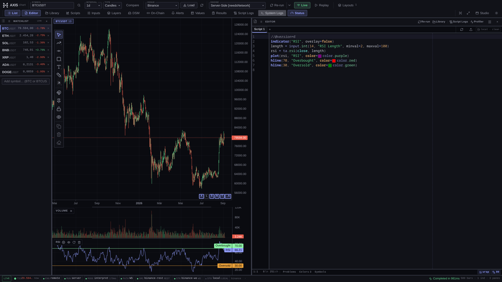
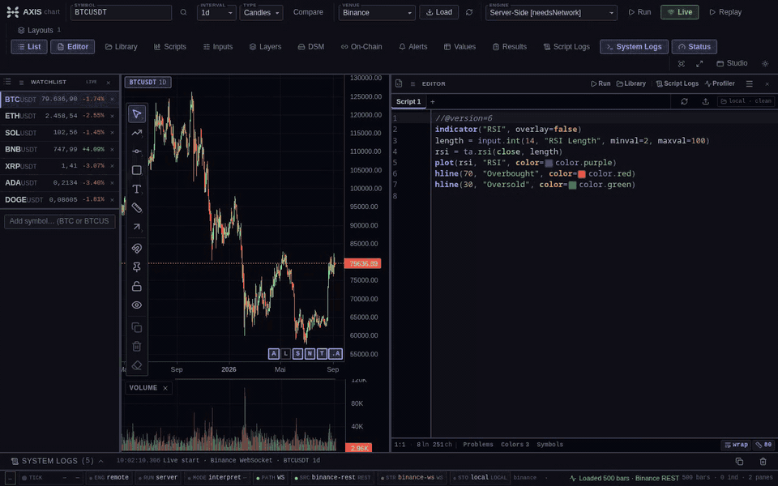
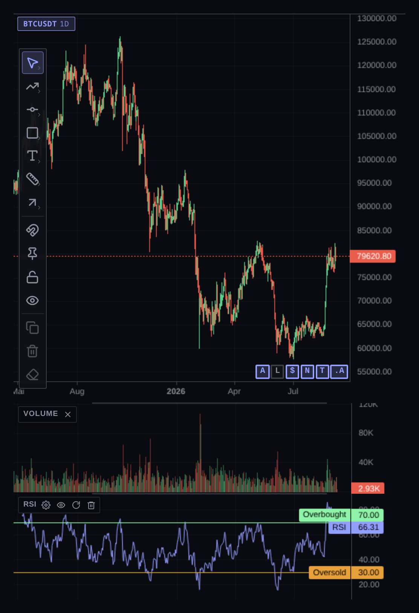
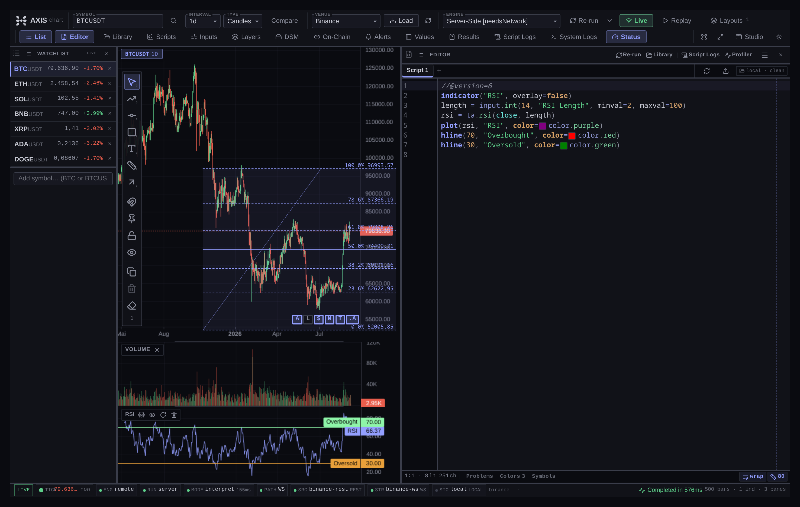
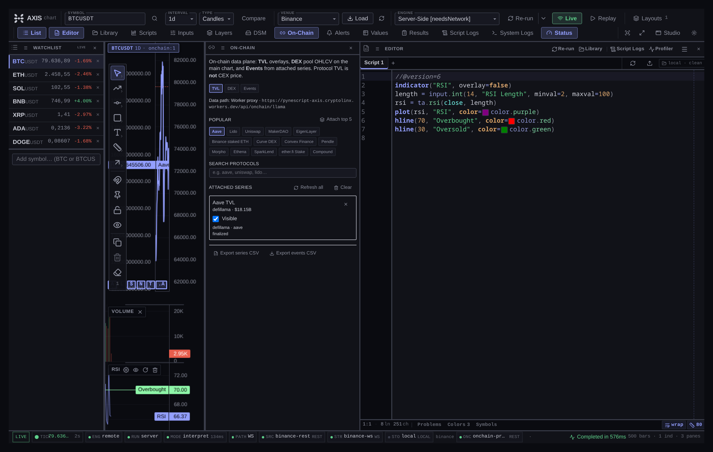
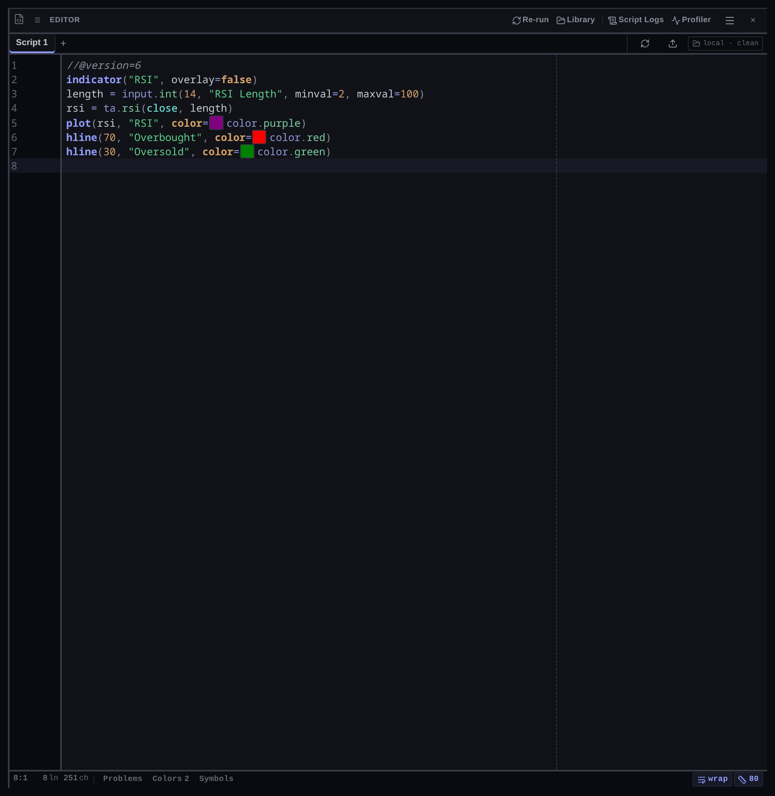
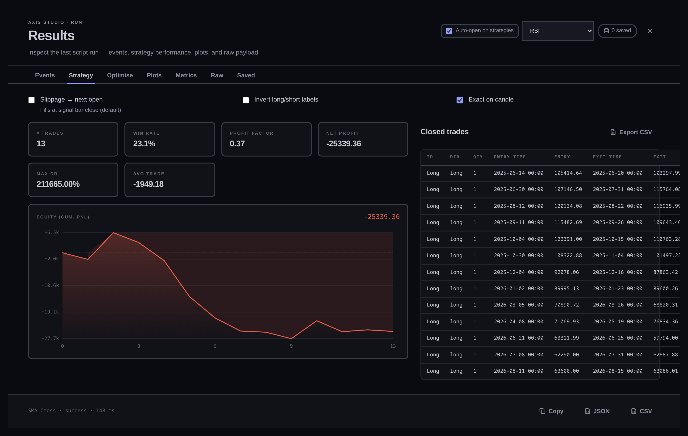
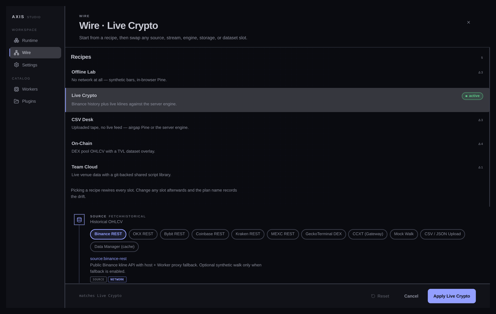

<!--
  Copyright (c) 2024–2026 HOOX · jango-blockchained (hoox-sh)
  SPDX-License-Identifier: AGPL-3.0-only
-->

# AXIS

An installable open charting PWA: CEX OHLCV, drawings, on-chain overlays, and Pine Script™ evaluation through PYNE.

AXIS is a Solid + Vite workspace. Historical bars, live streams, and calculation backends are plugins that share one TypeScript contract. Three engines: local PYNE Pro API (`:5002`), a Cloudflare Worker (`POST /api/run`), and in-browser Pyodide (offline). Evaluation never requires a proprietary chart host.

**2.25.3** · CLI [`@hoox-sh/axis-cli`](https://www.npmjs.com/package/@hoox-sh/axis-cli) **0.3.5** · demo [axis.hoox.sh](https://axis.hoox.sh)

<div align="center">

[](https://github.com/hoox-sh/axis/actions/workflows/ci.yml)
[](https://codecov.io/gh/hoox-sh/axis)
[](https://www.typescriptlang.org/)
[](https://bun.sh)
[](https://hoox.sh/axis)
[](https://www.npmjs.com/package/@hoox-sh/axis-cli)
[](LICENSE)

[hoox.sh/axis](https://hoox.sh/axis) · [docs](https://hoox.sh/axis/docs) · [CHANGELOG](CHANGELOG.md)

</div>

<p align="center">
  
</p>

<p align="center">
  
</p>

| Chart | Drawings | On-chain |
| --- | --- | --- |
|  |  |  |

| Editor | Results | Studio |
| --- | --- | --- |
|  |  |  |

Gallery: [screenshots](https://hoox.sh/axis/docs/enduser/guides/screenshots) · [`docs/images/`](docs/images/).

AXIS is the **chart host**. [PYNE](https://github.com/hoox-sh/pyne) evaluates Pine; [HOOX](https://github.com/hoox-sh/hoox) is the execution mesh. All three publish under [hoox.sh](https://hoox.sh).

---

## Architecture

```
┌─────────────────────────── Browser (PWA) ─────────────────────────────┐
│  Service Worker · manifest · offline cache                            │
│  lightweight-charts · CodeMirror 6 Pine editor                        │
│  plugins: source · stream · engine · storage · dataset · component    │
└───────────────────────────────────────────────────────────────────────┘
            │  engine=server or stream=remote
            ▼
┌─────────────────────────── Backends ──────────────────────────────────┐
│  PYNE Pro API :5002   ·   Cloudflare Worker (/api/run, /mcp, D1, KV)  │
│  Pyodide in-tab (offline; vendored wheels in public/pyodide/)         │
└───────────────────────────────────────────────────────────────────────┘
```

| Part | Path | Role |
| --- | --- | --- |
| **App** | `src/` | Solid + Vite PWA — chart, editor, plugin registry, themes, service worker |
| **Datafeed** | `src/data/` | Backfill, validate, gap-fill, venue adapters, IDB bars cache |
| **Engines** | `src/engines/`, `src/workers/` | PYNE Pro API, Worker, Pyodide — one evaluate contract |
| **On-chain** | `src/onchain/` | DefiLlama TVL, GeckoTerminal pools, events, jobs, alerts |
| **Worker** | `worker/` | `/api/run`, `/api/stream`, `POST /mcp`, KV keys, D1 scripts, R2 cache, Git OAuth |
| **MCP host** | `src/mcp/` | In-tab dispatcher + Worker bridge (`window.__AXIS_MCP__`) |
| **Desktop** | `src-tauri/` | Optional Tauri 2 shell |
| **CLI** | `packages/cli/` | `@hoox-sh/axis-cli` — install, doctor, setup, secrets, deploy, health, MCP |
| **Datafeed sidecar** | `packages/datafeed/` | Optional Bun CCXT Pro gateway (`/health`, `/ohlcv`, `/watch`) |

Plugin kinds: `source` (history), `stream` (live), `engine` (calc), `storage` (local / git / cloud), `dataset` (on-chain), `component` (UI slots). Registry: `src/plugins/registry.ts`. Dynamic load: `loadPluginFromUrl()`. Built-ins include Binance / OKX / Bybit / Coinbase / Kraken REST, Binance WS, mock walk, CSV, DefiLlama TVL, GeckoTerminal OHLCV, `server` and `pyodide` engines. Boilerplate: [axis-plugin-boilerplate](https://github.com/hoox-sh/axis-plugin-boilerplate).

Optional **PYNE Agent** plugin (NL → Pine, standalone Workers AI): Manager → Plugins → Install, or your own origin from [pyne-agent-worker](https://github.com/hoox-sh/pyne-agent-worker). Docs: [PYNE Agent](./docs/enduser/guides/pyne-agent.mdx).

---

## CLI and MCP

Node ≥ 20 for the published CLI. Bun ≥ 1.2 for install / dev / build in this tree.

```bash
npm install -g @hoox-sh/axis-cli

axis install
axis doctor
axis setup --github-client-id Ov23li…
axis setup d1 --remote
axis secret put ADMIN_TOKEN
axis deploy
axis health --oauth
axis keys create                 # pn_…
axis mcp config --key pn_…
```

Repo aliases: `bun run axis --help`, `bun run axis:install`, `make axis-doctor`. Docs: [AXIS CLI](./docs/devops/cli.mdx) · [packages/cli/README.md](./packages/cli/README.md).

Remote MCP on the Worker so agents can load a symbol, edit Pine, run a script, and inspect results.

| Plane | Live tab | Tools |
| --- | --- | --- |
| **Worker** | No | `axis_health`, `axis_request`, `axis_run`, scripts, keys, on-chain, market |
| **App** | Yes — this browser session | `app_invoke` / `app_get` / `app_set` |

```json
{
  "mcpServers": {
    "axis": {
      "url": "https://worker.axis.hoox.sh/mcp",
      "headers": { "Authorization": "Bearer pn_…" }
    }
  }
}
```

Paste the key in Studio → Settings → Worker. Keep Settings → MCP → Connect this tab on. `GET /mcp` is public discovery; tool calls use API-key auth. App tools return `SESSION_OFFLINE` until a tab is bridged. Docs: [MCP](https://hoox.sh/axis/docs/enduser/guides/mcp).

---

## Local dev

```bash
# Terminal 1 — PYNE Pro API (clone hoox-sh/pyne; directory is often still pynescript)
make -C ../pynescript run          # Flask :5002

# Terminal 2 — AXIS
bun install && bun run dev         # Vite :3000, proxies /run → :5002
```

Production static: `bun run build` then `python3 axis_pwa_server.py` (`dist/` on `:8081`). Desktop: `bun run desktop:dev` (Tauri 2; see [desktop](./docs/devops/desktop.mdx)).

Offline: Source = Mock Walk, Stream = Mock Poll, Engine = Pyodide. Disable the network in DevTools — Run still executes.

Live candles are Lightweight Charts. The ingest worker owns `/ws/live` and decodes AXB1 by default ([live engine](https://hoox.sh/axis/docs/architecture/hp-engine)). CORS is enforced by the API you call (Pro API or AXIS Worker), not by the static PWA — [CORS](https://hoox.sh/axis/docs/devops/cors-and-origins).

---

## Documentation

| | |
| --- | --- |
| Product docs | [hoox.sh/axis/docs](https://hoox.sh/axis/docs) |
| On-chain | [guide](https://hoox.sh/axis/docs/enduser/guides/on-chain) |
| Data sources | [manager](https://hoox.sh/axis/docs/enduser/guides/data-source-manager) |
| MCP | [agents](https://hoox.sh/axis/docs/enduser/guides/mcp) · [Worker](https://hoox.sh/axis/docs/worker/mcp) |
| CLI | [devops](https://hoox.sh/axis/docs/devops/cli) |
| Worker | [API](https://hoox.sh/axis/docs/worker) |
| Changelog | [`CHANGELOG.md`](CHANGELOG.md) |

---

## Ecosystem

```
                    https://hoox.sh
           ┌──────────────┼──────────────┐
           ▼              ▼              ▼
         HOOX            PYNE           AXIS
    (edge execution)  (Pine engine)  (charting UI)
```

| Product  | Role                                                         | Docs                                           |
| -------- | ------------------------------------------------------------ | ---------------------------------------------- |
| **HOOX** | Signal in → risk → CEX / DEX hop → notify                    | [docs.hoox.sh](https://docs.hoox.sh)           |
| **PYNE** | Pine Script™ grammar, AST, dual-engine runtime, LSP, Pro API | [hoox.sh/pyne/docs](https://hoox.sh/pyne/docs) |
| **AXIS** | Installable charting PWA (this repo)                         | [hoox.sh/axis/docs](https://hoox.sh/axis/docs) |

Satellites: [PyneTS](https://github.com/hoox-sh/pynets), [pyne-worker](https://github.com/hoox-sh/pyne-worker), [pyne-agent-worker](https://github.com/hoox-sh/pyne-agent-worker), [axis-plugin-boilerplate](https://github.com/hoox-sh/axis-plugin-boilerplate). HOOX isolate list: [hoox-sh/hoox](https://github.com/hoox-sh/hoox#architecture).

---

## License

**SPDX:** `AGPL-3.0-only` · Copyright (C) 2024–2026 jango_blockchained · [LICENSE](./LICENSE).

Educational and research use. Trading involves substantial risk of loss. This is not financial advice.

_Pine Script™_ and _TradingView®_ are trademarks of [TradingView, Inc.](https://www.tradingview.com/); _Cloudflare®_ is a trademark of Cloudflare, Inc. AXIS is independent and is not affiliated with, authorized by, sponsored by, or endorsed by TradingView, Inc. or Cloudflare, Inc.
