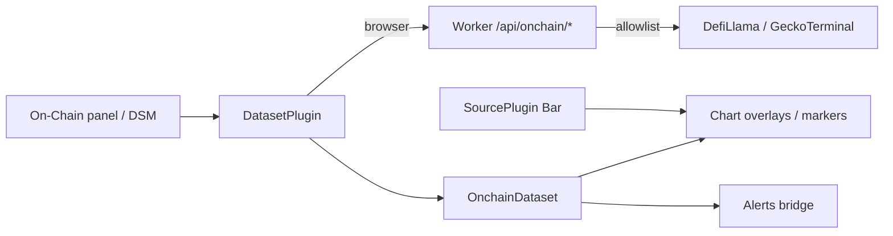
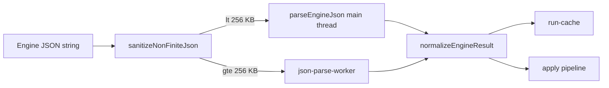

# Copyright (c) 2026 HOOX · AXIS · hoox-sh (jango_blockchained)
#
# This file is part of axis.
#
# axis is free software: you can redistribute it and/or modify
# it under the terms of the GNU Affero General Public License as published by
# the Free Software Foundation, either version 3 of the License, or
# (at your option) any later version.
#
# axis is distributed in the hope that it will be useful,
# but WITHOUT ANY WARRANTY; without even the implied warranty of
# MERCHANTABILITY or FITNESS FOR A PARTICULAR PURPOSE.  See the
# GNU Affero General Public License for more details.
#
# You should have received a copy of the GNU Affero General Public License
# along with axis.  If not, see <https://www.gnu.org/licenses/>.
#
# SPDX-License-Identifier: AGPL-3.0-only

---
title: "Architecture Decision Records"
description: "ADR-001 through ADR-018 for AXIS: registry, AXIS≠engine, Solid+Vite, engines, plugins, storage, CF ids, proxies, DO fan-out, CORS, results, telemetry, on-chain, provider lock, narrow bar plane, engine result parse."
---

# Architecture Decision Records

Formal ADRs for AXIS (product + the repo root). Status values: **Accepted** unless noted. Dates are conceptual product epochs, not git archaeology.

## Index

| ID | Title |
| --- | --- |
| [ADR-001](#adr-001-pluggable-unified-registry) | Pluggable unified registry |
| [ADR-002](#adr-002-axis--engine) | AXIS ≠ engine |
| [ADR-003](#adr-003-solid--vite-product-ui) | Solid + Vite product UI |
| [ADR-004](#adr-004-built-in-engines) | Three built-in engines (server, pyne-worker, Pyodide) |
| [ADR-005](#adr-005-declarative-configschema) | Declarative configSchema |
| [ADR-006](#adr-006-url-loadable-plugins) | URL-loadable plugins |
| [ADR-007](#adr-007-storage-as-a-plugin) | Storage as a plugin |
| [ADR-008](#adr-008-frozen-cf-project-id) | CF ids: Pages `axis`, Worker `worker-axis` |
| [ADR-009](#adr-009-worker-proxies-first) | Worker proxies first |
| [ADR-010](#adr-010-durable-object-stream-fan-out) | Durable Object stream fan-out |
| [ADR-011](#adr-011-state-namespace-migration) | State namespace migration |
| [ADR-012](#adr-012-cors-as-deploy-concern) | CORS as deploy concern |
| [ADR-013](#adr-013-results-export-in-axis) | Results export in AXIS |
| [ADR-014](#adr-014-transport-preference--connection-telemetry) | Transport preference + connection telemetry |
| [ADR-015](#adr-015-on-chain-data-plane) | On-chain data plane |
| [ADR-016](#adr-016-provider-locked-market-data) | Provider-locked market data; CCXT on the server |
| [ADR-017](#adr-017-narrow-bar-plane) | Narrow bar plane (`barPlane`) separate from `store.bars` |
| [ADR-018](#adr-018-engine-result-parse--typed-contract) | Off-thread engine JSON parse + typed result contract |

---

## ADR-001: Pluggable unified registry

### Context

Early AXIS registered sources/streams/engines in separate ad hoc maps. Operators and authors needed one mental model and one install path.

### Decision

Adopt a **unified `PluginRegistry`** (`src/plugins/registry.ts`) with kinds:

`source | stream | engine | storage | component(reserved)`

Every plugin shares `PluginBase` (`id`, `name`, `kind`, `description`, `version`, `builtIn`, `configSchema`, `capabilities`, lifecycle hooks). Registration is ordered; listeners observe register/unregister.

### Consequences

- Active selection lives in the Solid store, not the registry.
- Built-ins protected from casual unregister.
- Catalogs (`sources/catalog.ts`, …) become registration facades.
- Contract docs under [Plugins](/axis/docs/plugins).

---

## ADR-002: AXIS ≠ engine

### Context

Closed chart hosts couple rendering and language runtime. That blocks offline mode, alternate evaluators, and headless reuse of PYNE.

### Decision

**AXIS never embeds a closed interpreter.** All evaluation goes through `EnginePlugin.run`. UI modules call `getActiveEngine()` / `runAndApply`, not Python bindings directly (except inside the pyodide engine module).

### Consequences

- Language fidelity owned by [PYNE](/pyne/docs/runtime).
- AXIS docs do not duplicate grammar theory.
- New engines (tiny demo, remote Worker, future WASM) are additive plugins.

---

## ADR-003: Solid + Vite product UI

### Context

Pre-2.21.0 vanilla JS shell (`main.js`, `style.css`) mixed DOM wiring with business logic and aged TV-blue tokens. Removed in 2.21.0.

### Decision

Product path is **SolidJS + Vite + Tailwind 4**, entry `src/index.tsx` / `app.tsx`. Imperative chart library (lightweight-charts) is isolated in `ChartHost` / `PaneManager` so Solid reconciliation does not thrash canvas DOM.

### Consequences

- Legacy files retained for smoke/static tests only (`LEGACY.md`).
- Icons via `lucide-solid`.
- Deploy artifact is Vite `dist/`, not repo-root static tree.

---

## ADR-004: Built-in engines

### Context

Researchers need server fidelity, an edge evaluator, and offline demos. A single transport cannot satisfy all three.

### Decision

Ship three built-in engines (`BUILTIN_ENGINES` in `src/engines/catalog.ts`). `pyne-worker` is `builtIn: true`. It is not a URL you paste onto the `server` engine.

| Id | Role |
| --- | --- |
| `server` | WebSocket `/ws/run`, then `POST {endpoint}/run`. Default endpoint `http://localhost:5002` (Flask Pro API) or the AXIS Worker. |
| `pyne-worker` | HOOX edge evaluator. Same `/run` contract, default origin the production pyne-worker. |
| `pyodide` | In-browser Python + vendored pynescript / antlr wheels. |

All three implement `EnginePlugin` and return `RunResult`.

### Consequences

- Endpoint field only for server-like engines.
- Pyodide requires correct static asset deployment (ZIP integrity checks).
- Timeouts unified at runner layer.

---

## ADR-005: Declarative configSchema

### Context

Per-plugin settings UIs do not scale; custom React/Solid forms per plugin forks the manager.

### Decision

Plugins declare optional **`configSchema`**: map of field name → `{ type, default, label, options, min, max, ... }`. Settings and library panels resolve defaults + `pluginsConfig` overrides via shared resolve helpers.

### Consequences

- New plugins get settings UI without shell changes (within field types).
- Types: `string | number | boolean | select` initially.
- Invalid user values remain a plugin responsibility at runtime.

---

## ADR-006: URL-loadable plugins

### Context

Third-party sources/engines should not require rebuild of the PWA for experiments.

### Decision

Support **`loadPluginFromUrl`**: fetch ES module, validate shape, register, persist install metadata for restore on boot. Example plugins published under `public/plugins/`.

### Consequences

- Browser origin trust model: URL plugins are code execution.
- Security tests constrain schemes and storage-via-URL footguns.
- Offline restore needs prior successful fetch/cache.

---

## ADR-007: Storage as a plugin

### Context

Script library began as localStorage-only; cloud and git were bolted differently.

### Decision

**Storage is a first-class plugin kind** with `list/read/write/remove` (+ optional draft/sync/status). Built-ins: `local` (IDB), `cloud` (Worker `/api/scripts`), `git` (GitHub/GitLab Contents API). Active storage in `activePlugins.storage`.

### Consequences

- Manager Script Library is backend-agnostic.
- Git commits only on explicit save; drafts local.
- Cloud uses Bearer Pro keys and optional optimistic concurrency.

---

## ADR-008: Frozen CF project id

### Context

Renaming Cloudflare® Pages/Worker projects severs KV/D1/R2 bindings, custom domains, and CI secrets. Product brand evolved to AXIS. The original freeze used a single id `pynescript-axis` for both Pages and the Worker.

### Decision

**Pages project is `axis`.** Canonical URL `https://axis.hoox.sh` (custom domain). Preview hashes live on `*.axis.pages.dev`. The previous Pages id `pynescript-axis` remains a CORS legacy alias for old preview hosts.

**Worker script is `worker-axis`.** Canonical URL `https://worker.axis.hoox.sh` (custom domain). Health JSON `service` is `worker-axis`. The pre-rename workers.dev host (`pynescript-axis.<account>.workers.dev`) is treated as a legacy alias in client host matching.

Brand in UI/manifest/docs is AXIS.

### Consequences

- `wrangler.toml` `name` is `worker-axis`; Pages `--project-name` is `axis`.
- Canonical hosts: Pages `https://axis.hoox.sh`, Worker `https://worker.axis.hoox.sh`.
- Docs call out the split explicitly (this ADR).
- npm package name (`axis-worker`) may lag brand.

---

## ADR-009: Worker proxies first

### Context

In-Worker Pyodide is attractive but heavy; production needed a path immediately.

### Decision

Worker **`/api/run` proxies to an external Python backend** first (`EXTERNAL_BACKEND`). In-Worker runtime remains scaffolded/gated. Keys, usage metering, scripts API, and stream DO can ship independently of full edge evaluation.

### Consequences

- AXIS `server` engine talks to Worker URL transparently.
- Operational dependency on Flask (or equivalent) until edge runtime matures.
- Clear layering: Worker is data plane + auth, not necessarily the interpreter.

---

## ADR-010: Durable Object stream fan-out

### Context

N browser clients each opening venue WebSockets waste connections and risk rate limits.

### Decision

**`SessionDO` Durable Object**: one upstream WS per session key; fan-out to N client sockets via `/api/stream`. Hibernation-friendly design on CF.

### Consequences

- Stream plugins may target DO URLs (example plugin provided).
- Session/symbol/interval query params are part of the contract.
- Not a historical source—live only.

---

## ADR-011: State namespace migration

### Context

Hard-renaming storage namespaces would brick user layouts and libraries if keys changed hard.

### Decision

Canonical key **`pynescript.axis.v1`**. On read, fall back to `pynescript.axis.v2` (and parallel library/draft keys), then **write forward**. Do not keep dual-write forever.

### Consequences

- Seamless upgrade for existing browsers.
- Persistence strips bars/lastRun/logs.
- Tests cover migration (`tests/state.test.ts` patterns).

---

## ADR-012: CORS as deploy concern

### Context

Browser AXIS on origin A calling Pro API on origin B fails without CORS. Hardcoding origins in AXIS is wrong.

### Decision

**CORS is a backend/deploy configuration** (`ALLOWED_ORIGINS` on Flask; Worker headers as deployed). AXIS documents required origins; ops sets explicit lists in production (avoid perpetual `*` outside demos).

### Consequences

- Localhost regex for dev.
- Troubleshooting centers on preflight, not engine code.
- Static file server does not replace API CORS.

---

## ADR-013: Results export in AXIS

### Context

Researchers need artifacts (trades CSV, run JSON) without a separate analytics service.

### Decision

**Results panel owns export**: download JSON of `lastRun`, CSV of closed trades, clipboard helpers. Strategy pairing and stats run client-side from engine events (`results/strategy.ts`, `results/events.ts`).

### Consequences

- Export fidelity bounded by engine event quality.
- No server-side report store required for MVP.
- Viewer metrics ≠ broker statements (documented for operators).

---

## ADR-014: Transport preference + connection telemetry

### Context

Operators need to see **how** data and calculation move (WS vs REST vs local vs brokered), whether the live socket is actually open, and engine run latency. Naively “prefer WebSocket everywhere” is wrong: venues expose **history over REST** and **live klines over WSS**. Server engines batch-run over HTTP; Pyodide is local WASM.

### Decision

1. **Transport policy**
   - History → REST (or local mock/CSV).
   - Live → **WebSocket first**, paired per source via `defaultStreamForSource` (`binance-rest` → `binance-ws`, …).
   - Engine → **prefer `WS /ws/run`** on the Pro API when available (`flask-sock`); fall back to HTTP `POST /run`. Pyodide remains local.
   - Brokered → CF Durable Object / `needsProxy` streams surface as transport class **`broker`**.
2. **Honest stream state** — `connecting` until `onStatus({ state: 'open' })`; reconnect uses `reconnecting` / degraded telemetry, not false green.
3. **Venue streams use reconnect with exponential backoff** (`streams/reconnect-ws.ts`).
4. **Connection HUD** — StatusBar second row (`ConnectionHud`) reads ephemeral `store.telemetry` (SRC/STR/ENG/STO chips, tick pulse, engine latency). Persist only `telemetry.hud` prefs + `live.preferAfterLoad` / `live.rerunOn`.
5. **Live re-run modes** — `every-tick` (default) or `bar-close` (venue `Bar.closed` or bar time advance).
6. **Chart stability** — full `setDataToChart` only on history load (`chartDataGen`); live uses `appendBar`; overlay/script drawings update in place to avoid hide/show flash.

### Consequences

- UI never claims WS for historical load.
- Auto-live after Load is **on by default** (`preferAfterLoad`). Turn off in Settings → Live stream.
- Plugin capabilities may declare `transport`; otherwise HUD classifies from id/capabilities.
- See [Streams](/axis/docs/plugins/streams), [UI shell](/axis/docs/ui/ui-shell), [Overview](/axis/docs/architecture/overview).

---

## ADR-015: On-chain data plane

### Context

AXIS began as an **OHLCV-first** chart host: `SourcePlugin` / `StreamPlugin` deliver `Bar[]` (open, high, low, close, volume) for CEX and similar venues, then engines run Pine against that series. Operators also need **non-price market structure**:

| Need | Why `Bar` alone fails |
| --- | --- |
| Protocol TVL (USD) | Single scalar liquidity total, not OHLC |
| DEX pool candles | Same shape as bars, but different venue semantics, address/network keys, and page caps |
| Spike / unlock-style events | Discrete time markers with severity, not candles |
| Honest provenance | Provider, snapshot cadence, finality — not implied by “the chart symbol” |

Forcing these into the primary `Bar` pipeline would corrupt scale semantics (TVL vs price), invent fake OHLC for scalar metrics, and couple wallet/signing UX to read-only analytics.

### Decision

Ship a **parallel on-chain data plane** orthogonal to the OHLCV source/stream path:

1. **Plugin kind `dataset`** on the unified registry (`DatasetPlugin` in `src/plugins/types.ts`):
   - `fetchDataset(opts) → OnchainDataset`
   - optional `searchInstruments`
   - payload kinds: `ohlcv | scalar_series | multi_series | events | table`
   - required **provenance** + **finality** (`pending | safe | finalized | unknown`)
2. **Parallel plane modules** under `src/onchain/` (types, cache, keys, adapters, catalog, manager, events, alerts bridge) — not a new `Bar` field and not Pine output.
3. **Worker allowlist proxy** (`worker/src/onchain.ts`, routes under `/api/onchain/…`):
   - rewrite only known DefiLlama / GeckoTerminal paths
   - validate network ids and pool addresses
   - short-TTL isolate cache (`X-Axis-Onchain-Cache`)
   - client default bases from `store.endpoint` (`src/onchain/proxy.ts`)
4. **Chart UX**: attach as host-side overlays (left scale for scalars; separate series keys `onchain_*`); main market OHLCV stays on the right scale. Not wallet, not Pine plots.



### Alternatives considered

| Alternative | Rejected because |
| --- | --- |
| **Force into `Bar` / active source** | TVL is not OHLC; faking open=high=low=close lies to engines and the price scale. Multi-protocol attach becomes multi-symbol load thrash. |
| **Piggyback Pine `request.security` only** | Needs engine + script for every host overlay; no attach UI, no provider search, no finality UI. |
| **Browser → provider direct** | Public DefiLlama / GeckoTerminal hosts often lack CORS for arbitrary AXIS origins (ADR-012). |
| **Open reverse proxy (any URL)** | SSRF risk; Worker must **allowlist** path shape, not pass-through arbitrary upstream. |
| **Wallet-connected RPC as the plane** | Different product (signing, accounts, private RPC). On-chain here means **public analytics APIs**, not MetaMask. |

### Consequences

- **CORS / deploy** — browsers should use `{endpoint}/api/onchain/llama|gecko`; local Worker on `:8787` or deployed edge. Direct `baseUrl` overrides are for Node tests / trusted environments only.
- **Finality honesty** — DefiLlama TVL is typically a **daily snapshot**, not block-final chain state; Gecko OHLCV is **pool** sampling, not CEX marks. UI shows provenance lines; `synthetic` flags fabricated OHLC.
- **Not a wallet** — no signing, no injected providers, no private keys for this plane.
- **Not Pine** — overlays are host datasets; they do not replace `indicator()` / `strategy()` plots from the engine.
- **Engines unchanged** — active OHLCV source still feeds `EnginePlugin.run`; on-chain series do not silently become script `close`.
- **Cache** — client IDB dataset cache (`instrumentCacheKey`) plus Worker short-TTL memory; operators may see stale TVL briefly after large DeFi moves.
- **Security** — Worker rejects path traversal, invalid slugs/addresses, non-GET, and non-allowlisted Gecko paths.

### Phases shipped

| Phase | Capability | Primary surfaces |
| --- | --- | --- |
| **1 — TVL** | DefiLlama protocol TVL scalar history + search | `defillama-tvl` dataset, `src/onchain/defillama.ts`, llama proxy |
| **2 — DEX** | GeckoTerminal pool OHLCV + pool search | source `geckoterminal-ohlcv`, `src/onchain/geckoterminal.ts`, gecko proxy. Not a `DatasetPlugin`. |
| **3 — Events** | Derived day-over-day TVL spike/drop events (`tvl_spike` / `tvl_drop`) | `src/onchain/events.ts` → chart markers |
| **4 — Alerts** | Bridge events into alerts engine (`onchain_tvl_spike` / `onchain_event`) | `src/onchain/alerts-bridge.ts`, `src/alerts/engine.ts` |

Pro-only DefiLlama surfaces (raises, unlocks via `pro-api.llama.fi`) remain out of the free Worker allowlist.

### Code map

| Path | Role |
| --- | --- |
| `src/onchain/types.ts` | `OnchainDataset`, instruments, finality |
| `src/onchain/catalog.ts` | Built-in dataset registration |
| `src/onchain/manager.ts` | Attach / hide / detach store wiring |
| `src/onchain/proxy.ts` | Resolve Worker llama/gecko bases |
| `worker/src/onchain.ts` | Allowlisted proxy + health |
| `src/plugins/types.ts` | `DatasetPlugin` contract |

### Related docs

- [Datasets](/axis/docs/plugins/datasets) — plugin contract
- [On-Chain data (end user)](/axis/docs/enduser/guides/on-chain) — operator guide
- [Worker](/axis/docs/worker) — `/api/onchain/…` on the edge route table
- [ADR-001](#adr-001-pluggable-unified-registry), [ADR-009](#adr-009-worker-proxies-first), [ADR-012](#adr-012-cors-as-deploy-concern)

---

## ADR-016: Provider-locked market data

### Context

AXIS composes source × stream × engine, but **OHLCV aggregation is not composable**. Mixing Binance history with OKX live (or Kraken watchlist quotes on a Binance chart) silently poisons indicators, compare, watchlist, and cache. Prior to this ADR, source and stream were independently selectable, venue detection used plugin-id substrings, and the Binance synthetic fallback made network errors look like real data.

Key problems:

| Issue | Risk |
| --- | --- |
| Source and stream independently selectable in Topbar | User loads Binance REST + OKX WS — mixed candles |
| DSM `sourceId` seeded once from `store.source` | Backfill targets a different venue than the chart |
| Watchlist Kraken → Binance tickers | Mixed-provider quotes |
| Coinbase WS ticker → synthetic bars | Not exchange candles; OHLCV ≠ REST history |
| Binance `fallback: true` synthesizes random walk | Chart looks "live" with fake prices |

### Decision

Introduce **`ProviderSession`** — a first-class locked market-data identity that all aggregators inherit:

1. **`ProviderSession`** (`src/data/provider.ts`): `{ id, sourceId, streamId, venue, market, authMode, credentialId, gateway }`. Persisted without secrets. Every aggregator reads `getActiveProvider()` instead of raw URLs or plugin-id substrings.

2. **Auto-pairing**: Source changes always re-pair the stream via `defaultStreamForSource`. Explicit mismatch is allowed but shows a HUD `⚠ pair · Fix` chip.

3. **Plugin capabilities**: `venue`, `market`, `klineStream` on `PluginCapabilities`. Venues with `klineStream: true` emit exchange candles (not ticker buckets).

4. **Coinbase WS**: switched from ticker buckets to Advanced Trade venue candles, folded into chart interval via `foldVenueCandle`.

5. **Binance fallback**: defaults **off** (`fallback: false`). Network errors must not look like real data.

6. **Watchlist lock**: no silent Binance fallback for Kraken, Gecko, or unknown venues. Each shows a clear "no live mux" message.

7. **Credential vault** (`src/data/credentials.ts`): in-memory session-only vault for API key/secret/passphrase. Secrets never reach `persist()`, `pluginsConfig`, error-share, or CHANGELOG dumps. `redactSecrets` and `stripSecretKeys` enforce this.

8. **Venue HMAC signers** (`src/data/venues/`): thin Binance / OKX / Bybit / Coinbase / Kraken / MEXC signers. No CCXT in the browser.

9. **Signed Binance klines**: vault key → HMAC direct fetch → Worker `/api/market/binance/signed/klines` (request-scoped `X-Exchange-Key` / `X-Exchange-Secret`). 401/403 stays thrown — bad keys must not silently mix public klines.

10. **Cache key**: includes `providerId|market|authMode|symbol|interval`. Authenticated and public candles do not share cache slots.

### Ownership

```
┌─────────────────────────────────────────────────────────────────┐
│ AXIS (composition host)                                         │
│  ProviderSession (venue + market + auth mode + credential ref)  │
│  SourcePlugin  ── REST history / pagination / DSM / compare     │
│  StreamPlugin  ── venue kline WS (not ticker-synthesized bars)  │
│  Credential vault (browser session / optional persist / Tauri)  │
│  Datafeed Gateway client → pyne | worker | sidecar              │
└───────────────┬─────────────────────────┬───────────────────────┘
                │                         │
                ▼                         ▼
┌───────────────────────────┐   ┌─────────────────────────────────┐
│ PYNE [data]/[datafeed]    │   │ AXIS Worker                     │
│ CCXT + CCXT Pro           │   │ Thin HMAC REST proxy (no CCXT)  │
│ CLI, request.*, gateway   │   │ DO WS fan-out (public + auth    │
│ Secrets: env / key store  │   │ listenKey) — allowlisted paths  │
└───────────────────────────┘   └─────────────────────────────────┘
```

### Alternatives considered

| Alternative | Rejected because |
| --- | --- |
| **Bundle CCXT in browser** | ~1 MB+ bundle, Node APIs, isolate CPU, CORS issues |
| **CCXT in Cloudflare® Worker** | Bundle size, 128 MB memory, shared rate-limit IP, not designed for 100-exchange routing |
| **Keep venues as raw URL substrings** | Silent venue mismatches poison aggregation correctness |
| **Pluggable venue resolver** | Over-engineered; first-party venues are a fixed set of 5 |

### Consequences

- **Correctness** — aggregation (indicators, compare, watchlist, cache, DSM) inherits a locked venue. Mixed-provider bugs are structurally prevented.
- **Auth path** — public remains the default. Auth is a capability upgrade on the same provider, not a second source id.
- **Secret safety** — vault is RAM-only in v1. Tauri keychain / AES-GCM durable wrap is Phase 1.5. `pluginsConfig` and error-share are stripped of secret keys.
- **CCXT stays in PYNE** — server-side only. AXIS calls the gateway with session handles, never raw secrets in `/run`.
- **Long-tail exchanges** — AXIS `ccxt-rest` / `ccxt-ws` plugins that talk to a PYNE or Bun sidecar gateway. First-party venues stay thin native adapters.

### Key files

| Path | Role |
| --- | --- |
| `src/data/provider.ts` | `ProviderSession` type, `buildProviderSession`, `defaultStreamForSource` |
| `src/data/credentials.ts` | In-memory vault, `putCredential`, `redactSecrets` |
| `src/data/signed-fetch.ts` | Vault → HMAC → direct or Worker proxy |
| `src/data/venues/` | Per-venue HMAC signers (binance, okx, bybit, coinbase, kraken) |
| `src/plugins/active.ts` | `getActiveProvider()` |
| `src/plugins/types.ts` | `PluginCapabilities.venue`, `.market`, `.klineStream` |
| `src/store/index.ts` | `setActivePlugin` auto-pairing, `syncProviderSession` |
| `src/ui/ConnectionHud.tsx` | Venue label, pairing Fix button |
| `src/ui/SettingsDialog.tsx` | Data tab (exchange credentials) |
| `src/ui/error-share.ts` | `stripSecretKeys` redaction |
| `worker/src/market.ts` | Signed Binance klines proxy |

### Related docs

- [Sources](/axis/docs/plugins/sources) — source plugin catalog
- [Streams](/axis/docs/plugins/streams) — stream plugin catalog
- [Data Source Manager](/axis/docs/enduser/guides/data-source-manager) — DSM guide
- [Topologies](/axis/docs/architecture/topologies) — composition models
- [ADR-001](#adr-001-pluggable-unified-registry), [ADR-009](#adr-009-worker-proxies-first)

---

## ADR-017: Narrow bar plane

### Context

`AppState.bars` is a single Solid store array. A live tick that replaces or mutates `store.bars` notifies every `createEffect` / `createMemo` that read `store.bars` or `store.bars.length` — document title, status bar, quote card, volume profile, ChartHost overlays, even when they only need the forming tip. Phase 1 of the [Q4 2026 perf audit](/axis/docs/architecture/perf-audit-2026-11) measured that as the dominant reactivity cost on the live path.

Keeping one giant array as both the engine input and the UI subscription surface cannot stay under an 8 ms tick→paint budget at 5k–50k bars.

### Decision

Introduce a **narrow bar plane** at `src/stores/bars.ts` (`barPlane`) with four independent fields:

| Field | Updates when | Typical readers |
| --- | --- | --- |
| `bars` | full load, slot restore, rolling-window slide | engine apply, full-window paint |
| `tip` | every accepted live tick (cloned, never the same object as `bars[n-1]`) | last price, title, quote, HUD |
| `length` | grow or slide, not forming-tick overwrite | chrome that only needs count |
| `gen` | full reload / slide | result cache key, overlay invalidation |

Write path:

- `loadBars` / slot restore → `setBarPlaneFull`
- in-place append → `setBarPlaneAppend` (no whole-window copy)
- forming tick → `barPlane.tip` only (`flushLiveFrame`)

`store.bars` remains the durable engine/eval source during migration. New UI readers subscribe to `barPlane`, not `store.bars`.

The tip is **cloned** on full-window writes so the Solid store proxy for `barPlane.tip` cannot alias an element of `store.bars` (that aliasing broke `closed` mutation in `store-closed-on-new-bar.test.ts`).

### Alternatives considered

| Alternative | Rejected because |
| --- | --- |
| **Fine-grained signals on `store.bars[i]`** | Solid store array replace still notifies length/identity readers; does not split tip from window. |
| **Drop `store.bars` immediately** | Engine eval, DSM, and ChartHost paint still consume the full window; a hard cut would fork persistence. |
| **Shared typed-array buffer** | Follow-up (Phase 2 GC hygiene). Plane first, buffers later. |

### Consequences

- Live ticks that only move the forming OHLC must not bump `barPlane.gen` or copy `barPlane.bars`.
- Overlay/result caches key off `barPlane.gen` + `barPlane.length`, not array identity.
- Persistence still serializes `store.bars`. Do not persist the plane separately.
- ChartHost's full paint path may keep reading `store.bars` until a later phase moves it.

### Key files

| Path | Role |
| --- | --- |
| `src/stores/bars.ts` | `barPlane`, `setBarPlaneFull`, `setBarPlaneAppend` |
| `src/store/index.ts` | `loadBars` / `appendBar` / `flushLiveFrame` writers |
| `src/app.tsx`, `src/ui/StatusBar.tsx`, `src/ui/Topbar.tsx` | migrated readers |
| `src/indicators/run-cache.ts` | cache key includes `barsGen` + length |

### Related docs

- [Performance audit](/axis/docs/architecture/perf-audit-2026-11) — Phase 1 notes
- [State namespaces](/axis/docs/architecture/state-namespaces)
- [ADR-011](#adr-011-state-namespace-migration)

---

## ADR-018: Engine result parse + typed contract

### Context

Engine responses (`POST /run`, `/ws/run`, Pyodide `run`) return one JSON string that can be hundreds of KB to several MB (equity, plot series, trades). `JSON.parse` of a 10k-bar payload was measured at p99 ~7 ms on the main thread — most of the 8 ms tick→apply budget — before apply even starts. Python `json.dumps` can also emit bare `NaN` / `Infinity`, which standard JSON rejects.

A second cost: REST, WebSocket, and Pyodide used to present slightly different result shapes to the apply pipeline, so each path re-normalized plots, trades, and equity.

True *chunked* streaming of Pyodide evaluation is still outstanding (Phase 5 backlog). This ADR covers the parse/contract slice that already shipped.

### Decision

1. **Shared sanitizing parser** (`src/engines/json-sanitize.ts`):
   - `sanitizeNonFiniteJson` rewrites bare `NaN` / `Infinity` / `-Infinity` to `null` without touching string literals.
   - `parseEngineJson` is the synchronous path (small bodies, 413 peeks, tests).
   - `parseEngineJsonAsync` parses payloads **≥ 256 KB** in a module Worker (`src/engines/json-parse-worker.ts`). Below the threshold, or when `Worker` is unavailable, it falls back to `parseEngineJson`.
2. **Typed apply contract**: every engine path lifts through `normalizeEngineResult` (`src/indicators/run-helpers.ts`) to a `NormalizedRunResult` before ChartHost/apply. Pyodide, REST `/run`, WS `/ws/run`, and `/run/batch` share that shape.
3. **In-memory result cache** (`src/indicators/run-cache.ts`): successful non-live runs keyed by `(engineId, scriptId, scriptHash, inputs, config, barsGen, barsLength, libraries)`. Bounded 16 entries / 30 s TTL; cloned on store and retrieve; disabled in tests and for live ticks.
4. **Not this ADR**: incremental Pyodide line/mark streaming (`TransformStream`). Parse-off-thread of the *final* JSON string is the current win.



### Alternatives considered

| Alternative | Rejected because |
| --- | --- |
| **Always parse on main thread** | 10k OHLCV p99 ~7 ms already saturates the tick budget. |
| **Always off-thread** | Worker postMessage of a 1 KB status frame is slower than `JSON.parse`. Threshold 256 KB. |
| **Streaming JSON parser on main** | Extra dependency; Worker reuse is enough for the final blob. |
| **SharedArrayBuffer / typed-array wire** | Needs backend envelope changes; gated for a later contract rev. |

### Consequences

- Callers of `parseEngineJsonAsync` must `await`. Sync peeks stay on `parseEngineJson`.
- Worker startup is amortized via a shared module worker; tests call `_resetParseEngineJsonForTests`.
- Cache must not serve live ticks or mutated apply payloads (clone on write/read).
- Chunked Pyodide evaluation remains future work; do not advertise partial plots as complete.

### Key files

| Path | Role |
| --- | --- |
| `src/engines/json-sanitize.ts` | `parseEngineJson`, `parseEngineJsonAsync`, 256 KB threshold |
| `src/engines/json-parse-worker.ts` | Off-thread `JSON.parse` after sanitize |
| `src/indicators/run-helpers.ts` | `normalizeEngineResult` / `NormalizedRunResult` |
| `src/indicators/run-cache.ts` | Bounded memo of non-live runs |
| `src/engines/catalog.ts`, `live-sessions.ts`, `engine-ws.ts`, `batch.ts` | Call sites |

### Related docs

- [Performance audit](/axis/docs/architecture/perf-audit-2026-11) — Phase 3 notes
- [Evaluation](/axis/docs/architecture/evaluation)
- [ADR-002](#adr-002-axis--engine), [ADR-004](#adr-004-built-in-engines)

---

## ADR lifecycle

New ADRs should:

1. State context, decision, consequences.
2. Cross-link code paths.
3. Avoid re-litigating ADR-002 without supersession note.

## See also

- [Overview](/axis/docs/architecture/overview)
- [Topologies](/axis/docs/architecture/topologies)
- [Plugins contracts](/axis/docs/plugins/contracts)
- [Datasets](/axis/docs/plugins/datasets)
