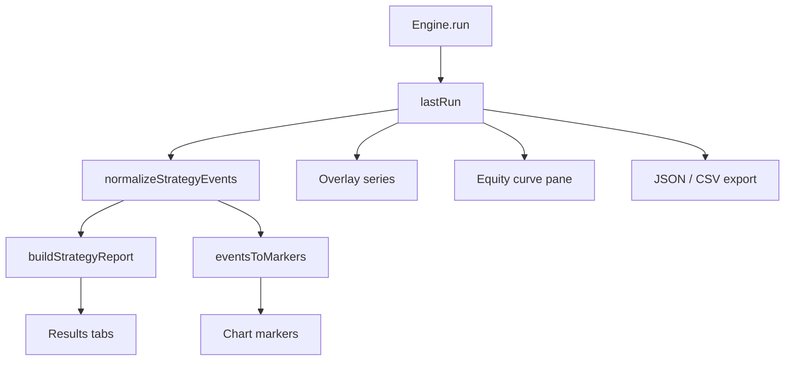

# Copyright (c) 2026 HOOX · AXIS · hoox-sh (jango_blockchained)
#
# This file is part of axis.
#
# axis is free software: you can redistribute it and/or modify
# it under the terms of the GNU Affero General Public License as published by
# the Free Software Foundation, either version 3 of the License, or
# (at your option) any later version.
#
# axis is distributed in the hope that it will be useful,
# but WITHOUT ANY WARRANTY; without even the implied warranty of
# MERCHANTABILITY or FITNESS FOR A PARTICULAR PURPOSE.  See the
# GNU Affero General Public License for more details.
#
# You should have received a copy of the GNU Affero General Public License
# along with axis.  If not, see <https://www.gnu.org/licenses/>.
#
# SPDX-License-Identifier: AGPL-3.0-only

---
title: "Strategy and results"
description: "How AXIS turns engine events into trades, stats, chart markers, equity, and exportable Results tabs."
---

# Strategy and results

After **Run**, the engine returns a structured payload. AXIS **AXIS** normalizes events, pairs trades, paints markers, and exposes a Results drawer. Strategy math here is a **viewer**—not a brokerage.


## Abstract

Engine `RunResult` (simplified):

```text
status: success | error
plots[] | series{}
events[]     — entries, exits, orders, custom
drawings[]   — Pine line/label/box objects
meta{}       — ms, overlay, script_name, plot_meta, …
error?
```

AXIS stores this as `store.lastRun` (in-memory; not fully rehydrated from localStorage).

## Conceptual model



## Results drawer tabs


| Tab | Operator value |
| --- | --- |
| **Events** | Chronological normalized stream (kind, time, price, id, dir) with a **Stream / Open⇄Close view switcher** — the Open⇄Close view groups events into pyramiding-aware position cycles (avg-entry parity with the pyne broker, per-fill P&L, jump-to-bar). A filter bar narrows the stream by text (kind / direction / id), by side (**All / Entries / Exits**), and by direction (**Both / long / short**), each chip carrying its count; `Esc` clears the filters without closing the overlay |
| **Strategy** | Single column: stats → equity → closed trades below, with return %, bars-held, and fill-count detail. A **Commission** control charges both legs of every trade |
| **Plots** | Series inventory (points, last value, **min / max / Δ%**) with the sparkline breaking on `na` gaps |
| **Metrics** | Runtime, status, engine, source, bars, high-level stats |
| **Raw** | Pretty-printed JSON for support / diffs |

Saved runs persist a JSON-safe strategy stats snapshot, so script-library rows show win %, profit factor, return %, max drawdown, and average trade at a glance. The **Saved** tab sorts by newest / oldest / net P&L / win % / trades, searches by label, kind, symbol, or timeframe, and supports per-row selection with a bulk delete. A shared walker (`walkStrategyEvents` in `src/results/strategy.ts`, positions in `src/results/positions.ts`) feeds trades, stats, positions, and the events stream.

### Strategy metrics

Computed by `buildStrategyReport`:

| Stat | Definition (viewer) |
| --- | --- |
| totalPnl | Sum of closed trade PnL (price units), **net of commission** when a model is set |
| winRate | % wins among closed trades |
| profitFactor | Gross profit / gross loss |
| avgTrade / avgWin / avgLoss | Means over closed set |
| maxDrawdown | Peak-to-trough on the cumulative trade PnL path, **in money** (what the UI shows) |
| maxDD | The same drawdown as a relative ratio, clamped to `[0, 1]` — legacy, not a % of capital |
| totalCommission / grossPnl | Σ fees charged and PnL before fees (only with a commission model) |
| wins / losses / trades | Counts |

### Commission

The engine nets commission into its own `strategy.closedtrades.profit`, but that figure never reaches the host, so the report re-derives P&L from prices and is **gross by default**. Turn on **Commission** on the Strategy tab to charge fees:

| Type | Charged per fill |
| --- | --- |
| `%` of notional | `\|price × qty\| × value / 100` |
| Cash / order | flat `value` |
| Cash / contract | `value × qty` |

Both the entry and the exit leg are charged. Pyramiding accumulates entry fees on the open position; a partial exit bills only its pro-rata share, so a position is never charged twice. Fees flow through net profit, win rate, profit factor, and the equity curve, and the trades CSV gains a `commission` column.

> A percentage **drawdown** needs a capital base, which this report does not model — P&L is in price × qty units. That is why Max DD is shown as money.

Pairing rules: entry-like kinds open by `id`; exit/close kinds match id or sole open trade. Direction flips short PnL. Missing prices drop the event from pairing (with normalization attempting OHLC fill from bars when available).

### Chart coupling

- Trade markers on the price pane (`eventsToMarkers`) show filled size as `Long N` / `Short N` (exits: order id + qty); missing engine qty keeps the id / `L`/`S`/`X` fallback
- Scroll-to-time on trade row click
- Equity curve series when strategy events warrant (`buildEquityCurve`)
- Status bar snippet: closed trade count · net PnL when available

## Export

| Export | Content |
| --- | --- |
| JSON | Full `lastRun` |
| CSV | Closed trades (`tradesToCsv`) — adds a `commission` column when a fee model is active |
| Clipboard | CSV of trades when supported |

Filenames: `axis-run-<ts>.json`, `axis-trades-<ts>.csv`.

## Interface surface

- Drawer height persisted (`resultsPanel.height`); open state toggled after runs (`openResults` default true for interactive runs)
- Silent live re-runs can skip auto-open
- Equity / indicator panes created on demand when non-overlay or strategy paths need them

## Worked example

1. Load `BTCUSDT` daily history.  
2. Run a crossover strategy (see [Quick start](/axis/docs/enduser/getting-started/quick-start)).  
3. Results → Strategy: inspect win rate.  
4. Click a green trade → chart jumps to entry.  
5. Export CSV for a notebook.

## Internals

| Path | Role |
| --- | --- |
| `src/ui/ResultsPanel.tsx` | Drawer UI |
| `src/results/strategy.ts` | Trade pairing + stats |
| `src/results/events.ts` | Normalize events, markers, equity |
| `src/indicators/runner.ts` | `runAndApply` orchestration |
| `src/chart/series-factory.ts` | Plot colors / series |

Language-level strategy semantics: [PYNE runtime](/pyne/docs/runtime).

## Invariants

1. Results are a function of **last successful/error payload + current bars**—changing bars without re-run can desync prices used for fill.
2. Viewer PnL is not currency-normalized; treat as relative tape units.
3. `meta.overlay === false` routes plots to an indicator pane, not price.
4. Pine drawings (script) are distinct from user drawing tools ([Drawings](/axis/docs/enduser/guides/drawings)).

## Failure modes

| Symptom | Explanation |
| --- | --- |
| Events but 0 trades | Only entries, or unpaired ids |
| Empty plots | Series all null / name filtered (`__` prefix hidden) |
| Markers missing | Manager not mounted or events lack times |
| Huge Raw JSON | Many events—export file rather than copy |

## See also

- [Quick start](/axis/docs/enduser/getting-started/quick-start)
- [AXIS — results and strategy](/axis/docs/ui/results-and-strategy)
- [AXIS — indicators](/axis/docs/ui/indicators)
