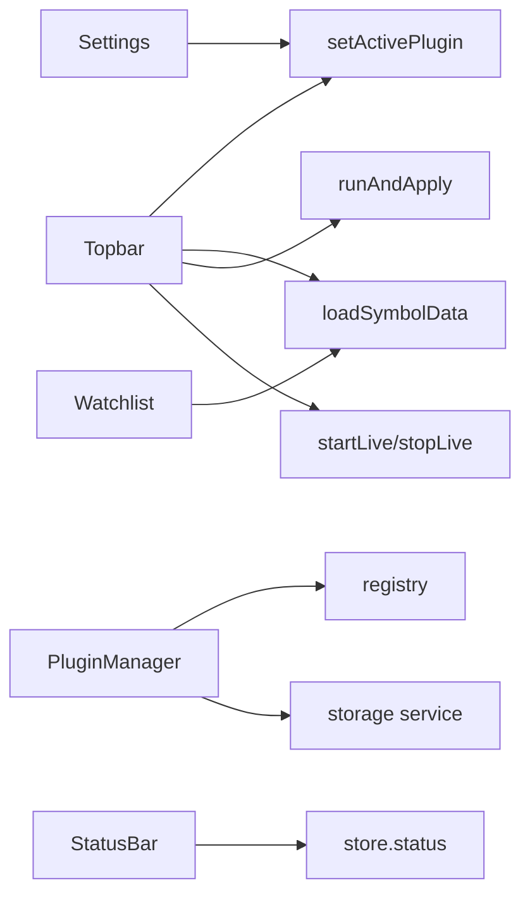

# Copyright (c) 2026 HOOX · AXIS · hoox-sh (jango_blockchained)
#
# This file is part of axis.
#
# axis is free software: you can redistribute it and/or modify
# it under the terms of the GNU Affero General Public License as published by
# the Free Software Foundation, either version 3 of the License, or
# (at your option) any later version.
#
# axis is distributed in the hope that it will be useful,
# but WITHOUT ANY WARRANTY; without even the implied warranty of
# MERCHANTABILITY or FITNESS FOR A PARTICULAR PURPOSE.  See the
# GNU Affero General Public License for more details.
#
# You should have received a copy of the GNU Affero General Public License
# along with axis.  If not, see <https://www.gnu.org/licenses/>.
#
# SPDX-License-Identifier: AGPL-3.0-only

---
title: "UI shell"
description: "AXIS chrome: topbar, watchlist, status bar, settings, plugin manager, logs, and layout chrome around the chart."
---

# UI shell

The shell is the non-canvas chrome: navigation of axes, market selection, modals, and status. It binds human gestures to store + plugins without owning calculation.

## Abstract

| Component | Path | Role |
| --- | --- | --- |
| Topbar | `ui/Topbar.tsx` | Axes pickers, Load/Run/Live, theme, modals |
| Watchlist | `ui/Watchlist.tsx` | Symbols, quotes, folders, click-to-load |
| StatusBar | `ui/StatusBar.tsx` | Status, engine/storage badges, trade snippet |
| StudioHost | `ui/studio/StudioHost.tsx` | Full-page Runtime / Wire / Settings / Workers / Plugins / Debug |
| SettingsPage | `ui/settings/SettingsPage.tsx` | Appearance, chart, live, keys, editor, theme |
| PluginsPage | `ui/plugins/PluginsPage.tsx` | Catalog / install / library |
| DebugPage | `ui/debug/DebugPage.tsx` | Logging switch, ring controls, live `[axis:*]` log view |
| WirePage | `ui/wire/WirePage.tsx` | Compose-recipe wiring (source × stream × engine × storage × dataset) |
| SystemLogs | `ui/SystemLogs.tsx` | Ring buffer of `store.logs` |
| ResultsPanel | `ui/ResultsPanel.tsx` | Bottom drawer (see results doc) |
| TablesPanel | `ui/TablesPanel.tsx` | Bottom **Tables** tab per script (`table.*` moved off-chart; see drawings guide) |
| Icons | `ui/icons.tsx` | Lucide wrappers |
| ResizeHandle | `ui/ResizeHandle.tsx` | Panel widths/heights |

## Conceptual model

## Topbar responsibilities

Grouped left→right (`axis-tb-group`, `data-tb-group`):

| Group | Contents |
| --- | --- |
| **brand** | Logo + AXIS |
| **market** | Symbol, Interval, Type (`TopbarField`), Compare |
| **data** | Source (+ CSV upload), Load, Reload (icon-only) |
| **compute** | Engine, Stream, **Run**, Live, Replay |
| **layout** | Multi-chart layouts + recipes |
| **panels** | List, Editor, Library, **Data** (Data Source Manager), **Scripts**, Layers, Alerts, Data window, Inputs, Results |
| **system** | Second-row trailing: theme, fullscreen, chart-only, **screenshot**, Studio |

| Control | Effect |
| --- | --- |
| Symbol / interval | Store + Load (Enter / blur reload) |
| Source / Stream / Engine | `setActivePlugin` + side effects |
| Chart type | `setChartType` (candles, HA, …) |
| Compare | Second-symbol overlay |
| Load / Reload | One-shot historical fetch → chart |
| **Data** panel | [Data Source Manager](/axis/docs/enduser/guides/data-source-manager) — background deep history |
| **Scripts** panel | Applied indicators/strategies list |
| Run | Editor doc → `runAndApply`; **accent only while `status === 'running'`** |
| Live | multiplex start/stop (stops Replay) |

### Chart themes

Settings / command palette expose **ten** curated presets (void dark/light, classic, mono, obsidian, graphite, pacific, dusk, porcelain, parchment). High-end soft surfaces — not neon high-contrast. See `src/theme/presets.ts`.
| Replay | Bar replay over loaded bars |
| Panel toggles | `isPanelOpen` / dual-write chrome |
| Settings / Plugins | Modal open |
| Detach editor | Bridge + popout |

Integrated labels: `ui/TopbarField.tsx` (`.axis-tb-field*`).  
`catalogTick` forces memo re-list when plugins install/remove.

### Command palette

**Ctrl/Cmd+K** — `CommandPalette` + `command-registry.ts`: panels, theme, layouts, Run, symbol focus, editor toggles (ruler, debug, pins, profiler), jump to line, git push/pull, save library. Palette entries render any recorded shortcut chords.

### Keyboard shortcuts

Global chord dispatch hub (`src/ui/shortcuts/`): capture-phase handling with a **dialog-skip guard** so shortcuts never fire while a modal is open. Wired to three scopes:

- **App-level** — palette, Run, panel toggles, replay, layouts
- **Chart** — keymap routed through the dispatch hub (cancel draft, layouts, replay)
- **Editor** — `src/editor/cm-line-ops.ts` `Prec.high` line ops: duplicate line, toggle comment, indent/unindent, delete line

Recorder and discovery:

- **Recorder**: Settings → Keyboard → record a chord; per-user overrides persist on the app store
- **Shortcuts modal**: lists default bindings with live rendering
- **Conflict flags**: scope-aware (`app.escape` vs `chart.cancel-draft` layer by design — no false conflict)

### Alerts panel

Dockable **Alerts** (`src/alerts/*` + `AlertsPanel.tsx`): local-first book for **price**, **% change**, **drawing touch**, **indicator plots**, **Pine `alert()` / `alertcondition()`**, and on-chain kinds. Delivery: browser Notification, optional HTTPS webhook, optional L2 webhook. Live ticks evaluate price/drawing/plot kinds; strategy/indicator runs evaluate Pine `alert()` events (last bar). Continuous server-side arming is not required for session use.

- **Header** — `/`-focus search across name, symbol, kind, and condition; a notification-permission bell; a `+ New` composer toggle; and a summary (`N alerts · N armed · N fired · N off`).
- **Composer** — collapsed by default once alerts exist (open when the book is empty). Fields follow the selected kind; **Delivery & cooldown** stays folded unless the alert uses it, and the summary line shows `browser · webhook · L2 · cooldown`.
- **Rows** — tone rail (armed / recently fired / off), enable dot, kind chip, symbol + condition, interval chip, relative last-fired (`2m ago`), and delivery glyphs. The `···` menu holds **Edit · Duplicate · Copy condition · Test webhook · Delete**; the bell toggles per-alert browser delivery.
- **Filters + bulk** — All / Price / Drawing / Indicator / On-chain chips carry live counts; the list menu enables all, disables all, or deletes all (confirm).
- Editing reuses the composer and preserves the alert's enabled state; deleting asks for confirmation. Formatting helpers (`formatLastFiredRelative`) live in `alerts/format.ts`.

### Data window panel

Dockable **Data Window** (`DataViewPanel.tsx` + `results/dataview.ts`) reads the bar under the crosshair and lists **Bar** (symbol / interval / UTC time / index), **OHLCV** (plus a **Change** row vs the previous close), **Plots** (respecting `display.data_window`), **Drawings** active at that time, and visible **On-chain** series.

- **Pin** freezes the inspected bar so it survives the pointer leaving the chart; **prev/next** step one bar at a time (from the pin or the last hovered bar).
- **Inspect last bar** fills the empty state when nothing is hovered.
- **Filter values** (`/` focuses it, `Esc` clears) narrows every group by label or value.
- **Copy** any row from its hover icon, or **copy all** as TSV from the header.
- Sections collapse from their heading and show live counts; the header reports the visible value count.

### Script settings (Inputs)

The **Script settings** modal (`ScriptSettingsModal.tsx`) edits Pine `input.*` values and `strategy()` Properties for an applied script or the editor document.

- **Filter** (`/` focuses, `Esc` clears) narrows groups by input label, id, or type; an empty result offers a **Clear filter** CTA. A copy button snapshots every input as `Label = value` lines.
- **Summary** — `N inputs · M changed`, where *changed* counts values that differ from the Pine declaration default.
- **Collapsible groups** — each Pine `group=` section folds from its heading with live counts (`M changed · N`); collapsed groups persist in `localStorage` (`axis.settings.collapsed`) across scripts, and groups holding changed values carry an amber rail.
- **Per-field reset** — modified fields show an amber dot and a hover **↺** that restores the Pine default; the footer **Reset** still resets the whole tab.

### Workspace snapshots

`storage/workspace-snapshot.ts` + optional chrome menus capture layout/plugin prefs for restore (distinct from OHLCV — bars still re-fetch on Load).

### Panel docks (side-by-side)

Left/right docks with **2+ open panels** lay out **horizontally** (row), not stacked under each other:

- Example: **Indicators** left of **Editor** on the right strip  
- Column width = **sum** of panel widths (capped)  
- Each panel keeps its own width (resize handle on chart-facing edge)  
- Bottom dock still stacks vertically  

See `ui/panels/dock-layout.ts`, `FloatableShell.tsx`.

## Mobile shell (phones / tablets)

`src/ui/mobile/MobileShell.tsx` + `src/ui/responsive.ts` — reactive `phone | tablet | desktop` mode from viewport + `pointer: coarse` (desktop ≥1024px is unchanged):

- **Phones (≤767px)**: compact header (brand · venue · symbol · interval) + bottom tab bar (**Chart · Panels · Editor · Studio · More**) replace the Topbar/StatusBar. Panels and More open as **nav overlays**.
- **Panel sheets**: docked/floating panels render as full-viewport sheets — one at a time, dismiss via **swipe-down** on the title bar. Desktop panel geometry is bypassed, never overwritten, so phone↔desktop switches preserve layouts. Phones boot chart-first.
- **Force-single chart**: 2H/2V/4 layouts collapse to the active slot with a slot-switcher chip row; other slots stay preserved in `store.chartLayout`.
- **Tablets (768–1023px)**: desktop shell with a horizontally scrollable topbar.
- Dialogs become **bottom sheets**; safe-area insets, `100dvh` root, ≥44px touch targets.

## Watchlist

- Default universe includes majors (`BTCUSDT`, …)
- Named lists persist (`watchlist.lists` + `activeId`); legacy `symbols`-only state migrates to a **Main** list
- **Folders** group lists (`watchlist.folders`, `list.folderId`). The manager drawer opens from the current-list button: create / rename / reorder / delete folders and lists, move lists between folders, and collapse a folder (persisted)
- Deleting a folder never deletes its lists — they return to **Ungrouped**
- **List actions** (`···`): rename, duplicate, move up/down, folder select, delete. Footer: **Sort A–Z** and **Clear** for the active list
- **Symbol actions** (`···` on a row): move up/down, move to another list, copy symbol, remove. Alerts and the big-price view stay one click away
- Row bell creates a price alert (cross / above / below) at last
- Big-price rows (`ui/watchlist-row.ts`): direction tint + optional 24h change
- `refreshSec` clamped 5–120
- Source-aware labels (e.g. CSV mode)
- Click sets symbol and loads through active source

## Extras (price card · ticker · time/price panels)

Optional floating widgets under the topbar (`ui/extras/`, toggled from the **Extra** menu):

- **Current price card** — live tick for the active symbol with trend tint over recent ticks.
- **Price ticker band** — marquee of watchlist symbols (seamless loop). Options: speed, direction, show 24h change, item spacing, band height, font size, opacity. Draggable when enabled; vertical offset resets from the menu. Symbol seed defaults to the watchlist (capped at 20).
- **Quote panel** — full quote sheet for the active symbol: a hero price with trend tint and a 24h change chip, a **24h range bar** marking the current price between the day low/high, day-open and 24h-volume tiles, last-bar **O/H/L/C** tiles, and tick-time / venue meta. The header shows the stream state (`open`, `idle`, …) and copies `SYMBOL price change` from the copy button.
- **Time / Price panels** — float-only clock (`timebadge.ts`: local/UTC + bar-countdown prefix) and big-price readouts docked under the topbar.
- State persists on `store.extras`; `anyExtraEnabled` drives the menu button state.

## Panel motion

Panel open/close runs a short ease-out height/opacity pass (`ui/effects/registry.ts`, `FloatableShell` / `DockColumn`) — snappy, no layout jump.

## Status bar

Single row:

- **Left — Connection HUD** (`ConnectionHud`, `data-testid="axis-connection-hud"`)
  - Live control. The word stays Live. An amber dot means reconnecting; the tooltip carries attempt and backoff. Offline is the failure state.
  - Tick pulse (fixed-width price + age)
  - **Compose** chip — engine, source, stream, and storage. Opens Data or Studio.
  - **Diagnostics** expands the raw eng / run / mode / path / src / str / sto chips. The preference persists (`telemetry.hud.diagnostics`).
- **Right** — `status` / `statusMessage`, strategy snippet, bar / scripts / pane counts

Connect MCP is a command-palette and mobile More action, not a status-bar chip.

Routine “loaded N bars” and stream reconnect lines stay in System logs. A toast fires when retries are exhausted, or when the stream recovers from an outage longer than 8s.

Telemetry planes are ephemeral (`store.telemetry`). Diagnostics, compact HUD, and live prefs persist.

### Live settings (Settings dialog)

| Setting | Default | Effect |
| --- | --- | --- |
| Enable live stream | on | `live.preferAfterLoad` → multiplex after Load and on boot when bars exist |
| Indicator re-run | every-tick | or `bar-close` only |
| Compact connection HUD | off | When diagnostics are on, hide source / stream / storage chips |
| Connection diagnostics | off | Status row shows Compose instead of raw chips |

## Logs

### System Logs strip

- `appendLog(level, message, source)`
- Cap `MAX_LOGS` (500)
- Not persisted
- Boot messages, pyodide ready, live errors

### Scriptlogs & Profiler

Script `log.*` output and editor line-timing live on a separate path — see [Debugging](/axis/docs/ui/debugging). Controls sit on the **editor header** (not the topbar) and do not write into `store.logs`.

## Theming

`store.theme` → `document.documentElement data-theme` (`dark` \| `light`). Void dark is default product aesthetic. Settings → **Theme** picks a curated preset (void / classic / mono / boutique) and edits chart tokens live.

## Accessibility / test hooks

E2E selectors use `data-testid` on critical controls (`axis-btn-load`, `axis-manager`, …) per `TESTING.md`.

## Invariants

1. Shell never calls Python.  
2. Plugin lists always come from registry facades (`listSources`, …).  
3. Modal settings persist only on Save (not on every keystroke of endpoint field until save).  
4. Live off leaves historical bars intact.

## Failure modes

| Symptom | Shell-side check |
| --- | --- |
| Pickers empty | Builtins not registered at boot |
| Live ignores click | Live is off (`stream: null`) or a multiplex error is in the logs |
| Settings probe fails | Network / CORS—not topbar bug |

## See also

- [Manager and settings](/axis/docs/enduser/guides/manager-and-settings)
- [Store](/axis/docs/ui/store)
- [Architecture overview](/axis/docs/architecture/overview)
